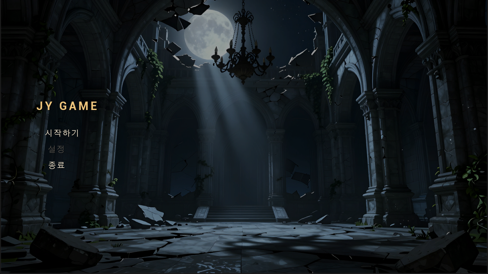
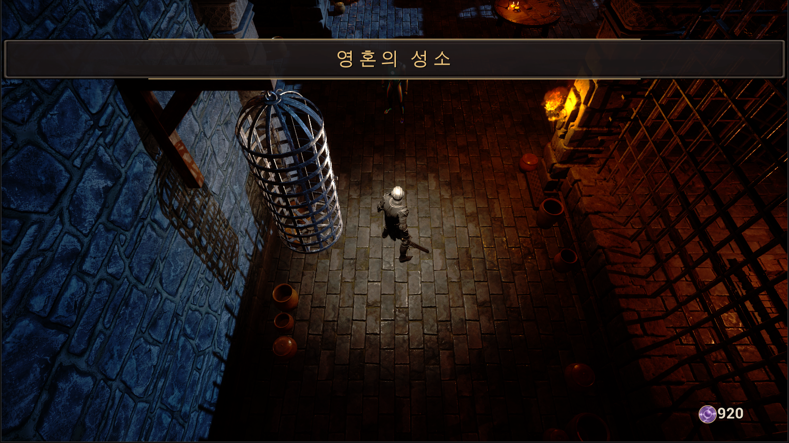
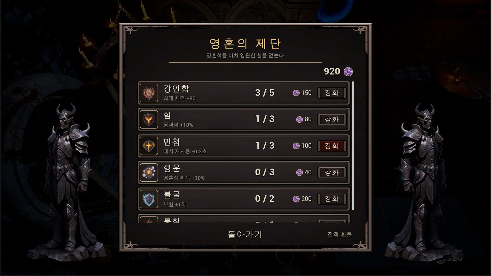
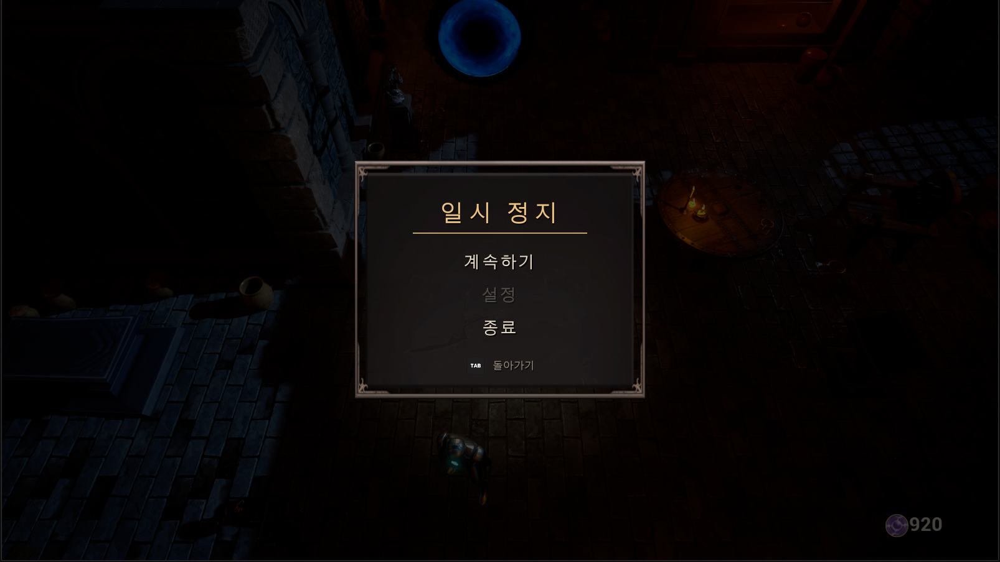
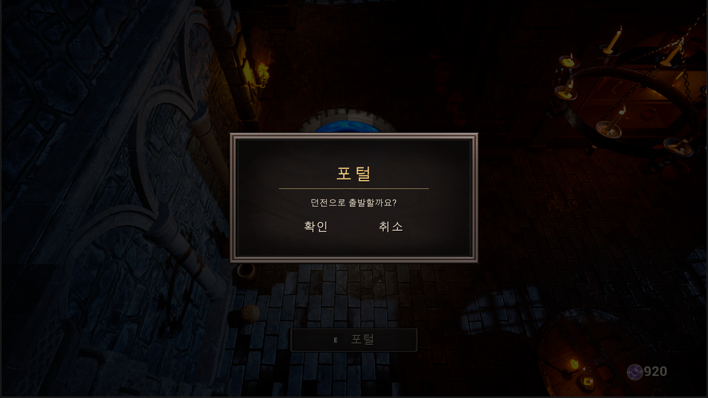
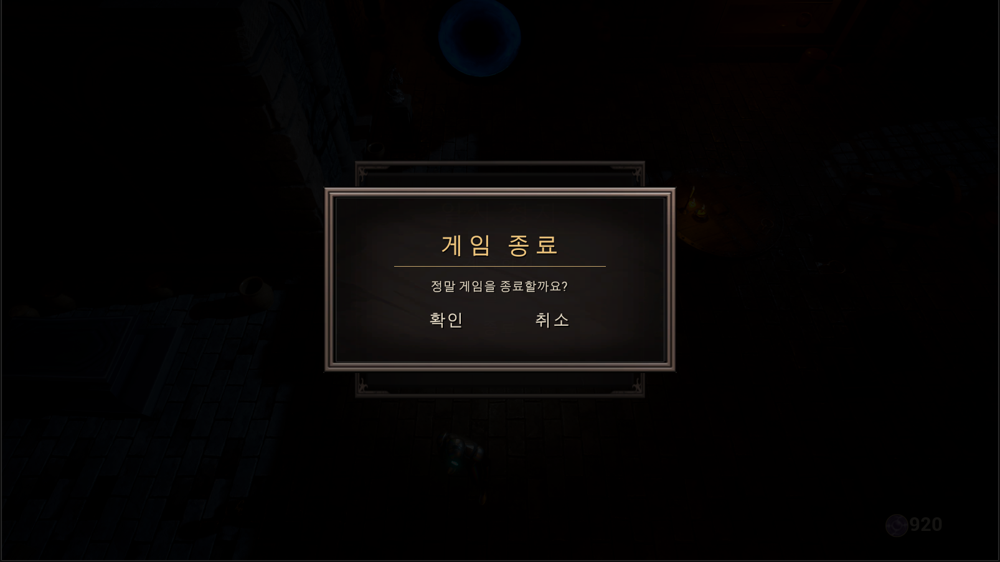
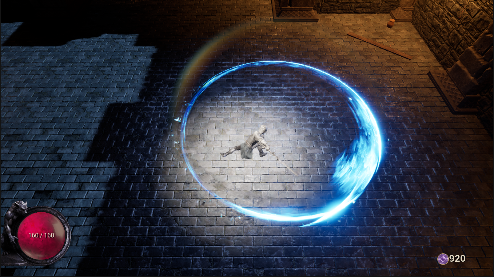

# JY_Roguelike (현재 진행 중)

## Milestones

> ✅ 완료 · 🚧 진행 중 · ⏳ 예정

| 영역 | 상태 | 완료 | 예정 |
|---|:---:|---|---|
| **Player Character** | ✅ 3/3 | 쿼터뷰 카메라 · 이동 GAS 기반 체력 시스템 사망 처리 | |
| **UI System** | 🚧 8/12 | CommonUI 기반 화면 층 구성 UI 관리자 Subsystem HUD (체력 · 영혼석) 정지 메뉴 확인 팝업 MVVM 데이터 바인딩 배너 · 토스트 알림 커스텀 커서 | 스킬 · 축복 슬롯 HUD 인벤토리 · 스탯창 설정 화면 피해 숫자 |
| **Lobby (Hub)** | ✅ 5/5 | 상호작용 시스템 기록판 포털 · 맵 이동 영혼의 제단 (메타 강화 구매 · 환불) 서버 세이브 | |
| **Movement** | ✅ 3/3 | 이동 애니메이션 점프 · 2단 점프 대시 | |
| **Title · Loading** | ✅ 3/3 | 타이틀 화면 로딩 화면 심리스 맵 이동 | |
| **Combat** | ✅ 6/6 | 기본 공격 콤보 (지상 · 공중) 서버 피격 판정 · 피격 반응 스킬 슬롯 · 쿨타임 찌르기 스킬 회피 내려찍기 스킬 | |
| **Camera** | ✅ 1/1 | 카메라를 가리는 벽 페이드 | |
| **Dungeon** | 🚧 6/8 | 방 6종 (전투 · 상점 · 보스) 함정 3종 부서지는 오브젝트 5종 레벨 스트리밍 기반 방 전환 무작위 방 순서 방 클리어 · 출구 문 잠금 | 오브젝트 파괴 연출 방 보상 · 문 위 보상 아이콘 |
| **Enemy** | ⏳ 0/3 | | Mass Entity 기반 대규모 적 웨이브 · 추격 · 전투 적 4종 · 엘리트 |
| **Boss** | ⏳ 0/2 | | 3페이즈 보스 패턴 보스 HP바 |
| **Blessing** | ⏳ 0/3 | | 축복 시스템 (3신 · 21종) 상태이상 (화상 · 빙결 · 감전) 축복 선택 화면 |
| **Run Loop** | ⏳ 0/3 | | 사망 · 클리어 → 허브 복귀 골드 · 상점 소모품 인벤토리 |

## 진행 상황 참고자료 (스크린샷)

> 2026-10-16 기준 PIE(Play As Client) 화면

| 타이틀 | 로비 도착 배너 |
|---|---|
|  |  |
| **영혼의 제단 (메타 강화)** | **정지 메뉴** |
|  |  |
| **포털 확인 팝업** | **종료 확인 팝업** |
|  |  |
| **던전 인게임 (HP 바)** | |
|  | |
