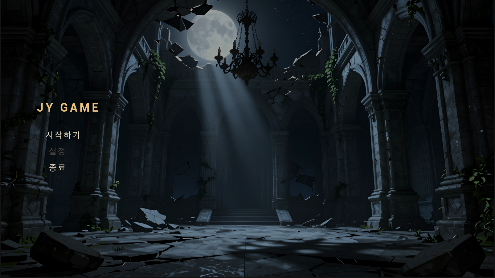
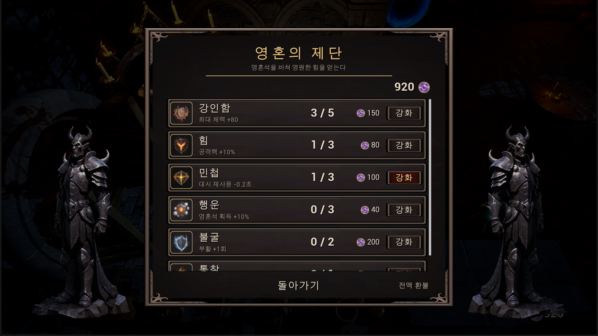
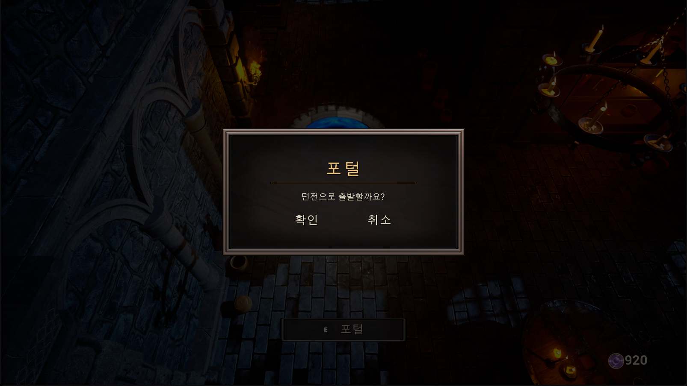

# JY_Roguelike (현재 진행 중)

## 프로젝트 소개

게임 「하데스(Hades)」의 방 단위 런 구조에 핵 앤 슬래시 전투를 넣은 3D 쿼터뷰 액션 로그라이크입니다. 축복 시스템은 하데스에서 착안했습니다.

 

## 개발 환경

펼치기 / 접기

| 구분 | 내용 |
|:---:|---|
| 엔진 | Unreal Engine 5.8 |
| 언어 | C++ |
| 사용 기술 | Gameplay Ability System · Mass Entity · MVVM (UMG ViewModel) |
| 네트워크 구조 | 서버·클라 분리 구조 (Play As Client) |

 

## AI 환경 및 활용 사례

펼치기 / 접기

### 환경

| 구분 | 내용 |
|:---:|---|
| 도구 | Claude Code |
| 공용 규칙 | - 작업의 큰 틀(방향 · 가이드라인)은 $\color{orange}{\textsf{사람이 먼저 정함}}$ - AI는 그 틀 안에서 레퍼런스(엔진 소스 · 공식 레퍼런스 프로젝트)를 확인해 설계안을 제시 - $\color{orange}{\textsf{사람이 첨삭해 확정}}$하고, $\color{orange}{\textsf{AI는 확정된 것만 구현}}$ - $\color{orange}{\textsf{추측 금지}}$ — 확인 못 한 것은 미확인으로 표시 - 커밋은 승인 후 |
| 스킬 | $\color{#2EC4B6}{\textbf{\textsf{설계 · 구현}}}$ - 구현 전 레퍼런스 확인 (엔진 소스 · 공식 레퍼런스 프로젝트) - 클래스 · 컴포넌트 · 인터페이스 등 구조 설계 기준 - Gameplay Ability System 구현 전 레퍼런스 구조 확인 - C++ 코딩 컨벤션 - 빌드 · 프로젝트 파일 생성 · 빌드 오류 추출 - 디버그 로그 · 상태 추적  $\color{#2EC4B6}{\textbf{\textsf{설명 · 문서}}}$ - 코드 · 엔진 동작 설명 형식 - 함수 호출 · 데이터 흐름 추적 - 클래스 다이어그램 (PlantUML) - 기능 흐름 HTML 페이지 - 전체 구조도 HTML 페이지 - 분석 문서 작성 - 문서 저장 위치 · 중복 방지  $\color{#2EC4B6}{\textbf{\textsf{에디터 · 에셋}}}$ - 에디터 MCP 호출 절차 - Fab 에셋 가져오기 - 프로젝트에 쓸 에셋 고르기 - 스크린샷 읽기 - 설명한 코드를 Visual Studio에 읽는 순서대로 열기 (헤더 · cpp 좌우 배치)  $\color{#2EC4B6}{\textbf{\textsf{작업 관리}}}$ - 진행 문서 기록 · 이어가기 - 두 세션 동시 작업 규칙 |
| 훅 | - 세션 시작 — 진행 문서의 다음 할 일을 자동으로 불러옴 - 빌드 명령 직전 — 에디터가 켜져 있는지 확인해 알림 - 파일 수정 후 — 고친 C++ 소스를 기록 - 응답 종료 전 — C++ 소스를 고치고 빌드하지 않았으면 끝내지 못하게 알림 - 입력 대기 — 윈도우 알림 |
| 에디터 연동 | - 언리얼 에디터 MCP - 에디터 전용 C++ 툴셋 (StateTree · AnimGraph · Level 등) |
| 진행 관리 | - 기능별 진행 문서에 기록 - 결정과 이유 · 지금까지 한 일 · 다음 할 일 · 막힌 문제 |

 

### 활용 사례

**1. 목표**

공격 판정, 피격 처리, 플레이어 길막이 캡슐 배치처럼 특정 위치 주변의 몬스터가 필요한 상황에서, 수백 마리인 몬스터 전체를 순회하지 않고 주변 몬스터만 검사하도록 최적화합니다.

**2. 진행 과정**

| 순&#8288;서 | 사람 (방향 · 결정) | AI (제안 · 조사 · 구현) |
|:---:|---|---|
| 1 | $\color{orange}{\textbf{\textsf{설계 제시}}}$ 공격 · 피격 · 캡슐 배치 때마다 몬스터 전체를 순회하는 것은 비효율적이므로, 같은 규격의 그리드를 새로 만들어 주변 몬스터만 검사하게 하려는데, 이 방식에 문제가 없는지 검토를 요청. | |
| 2 | | $\color{orange}{\textbf{\textsf{제안}}}$ 1. 길 찾기에 쓰는 NavMesh 플로우 필드를 쓰는 안. 2. 그리드를 새로 만드는 안. |
| 3 | $\color{orange}{\textbf{\textsf{거절}}}$ NavMesh 플로우 필드는 칸이 너무 잘게 쪼개져 있고 범위가 일정하지 않아 쓰지 않음.  $\color{orange}{\textbf{\textsf{결정}}}$ 같은 규격의 그리드로 나눠, 필요한 위치 주변의 칸만 보기로 결정.  $\color{orange}{\textbf{\textsf{지시}}}$ 그리드를 구현하기 전에, Mass에 같은 최적화가 이미 있는지 먼저 찾아볼 것. | |
| 4 | | $\color{orange}{\textbf{\textsf{조사}}}$ 엔진 소스에서 회피 기능이 그리드를 쓰고 있다는 것을 찾아옴. |
| 5 | $\color{orange}{\textbf{\textsf{확인}}}$ 그 엔진 코드를 직접 보고 칸이 고정 규격(2.5m)인 것을 확인.  $\color{orange}{\textbf{\textsf{결정}}}$ 공격 범위와 몬스터 크기에 적당하므로 이 그리드를 쓰기로 결정.  $\color{orange}{\textbf{\textsf{지시}}}$ 공격할 때 범위를 정하고, 그&nbsp;범위에&nbsp;걸친&nbsp;칸에서만&nbsp;몬스터를&nbsp;찾아올&nbsp;것. | |
| 6 | | $\color{orange}{\textbf{\textsf{구현}}}$ 지시대로 구현하고 빌드. |
| 7 | $\color{orange}{\textbf{\textsf{확인}}}$ 구현된 코드를 호출 흐름대로 직접 따라가며 확인.  $\color{orange}{\textbf{\textsf{최종 결정}}}$ 이 구조로 확정. | |

**3. 결과**

- 그리드를 불필요하게 만들지 않고 회피 그리드 사용.
- 공격 판정 · 피격 처리 · 플레이어 길막이 캡슐 배치에서 몬스터 전체 순회를 없애 최적화.

(수치 · 화면 추가 예정)

 

## 클래스 구조도

펼치기 / 접기

[클래스 구조도 보기](https://hanjongyun.github.io/JY_Roguelike/)

 

## Milestones

펼치기 / 접기

| 단계 | 목표 | 작업일 | 세부 항목 |
|:---:|:---:|:---:|---|
| **M1** | 기획 · 캐릭터 기반 | 4일 | ✅ 게임 기획 ✅ 에셋 후보 설정 ✅ 쿼터뷰 카메라 · 이동 ✅ GAS 기반 체력 시스템 ✅ CommonUI 도입 · UI 구조 설계 |
| **M2** | UI 시스템 | 2일 | ✅ CommonUI 기반 화면 층 구성 ✅ UI 관리자 Subsystem ✅ HUD (체력 · 영혼석) ✅ Tab 정지 메뉴 ✅ 확인 팝업 ✅ MVVM 데이터 바인딩 |
| **M3** | 로비 | 3일 | ✅ 배너 · 토스트 알림 ✅ 상호작용 시스템 ✅ 기록판 ✅ 포털 · 맵 이동 ✅ 영혼의 제단 (메타 강화 구매 · 환불) ✅ 서버 세이브 ✅ 맵별 HUD 표시 · 커스텀 커서 |
| **M4** | 이동 · 전투 | 4일 | ✅ 이동 애니메이션 · 점프 · 2단 점프 · 대시 ✅ 타이틀 · 로딩 화면 · 심리스 맵 이동 ✅ 기본 공격 콤보 (지상 · 공중) ✅ 서버 피격 판정 · 피격 반응 ✅ 스킬 슬롯 · 쿨타임 ✅ 찌르기 · 회피 · 내려찍기 ✅ 카메라를 가리는 벽 페이드 |
| **M5** | 던전 | 5일 | ✅ 방 6종 (전투 · 상점 · 보스) ✅ 함정 3종 ✅ 부서지는 오브젝트 5종 ✅ 레벨 스트리밍 기반 방 전환 ✅ 무작위 방 순서 ✅ 방 클리어 · 출구 문 잠금 ✅ 오브젝트 파괴 연출 |
| **M5.5** | 전투 리팩토링 | 2일 | ✅ 피격 반응 공용 컴포넌트 · 공중 넉백 ✅ 공격 · 함정 · 폭발 판정 통일 ✅ 함정 상태이상 (화상 · 독) ✅ GA 구조 개편 (공격 공용 부모 · AbilityTask 분리) ✅ GameplayEffect 데이터 에셋화 |
| **M6** 🚧 | **기본 몬스터** (M7과 동시 진행 중) | 12일 (진행 중) | ✅ Mass Entity 구조 설계 ✅ 서버 → 클라 복제 ✅ 웨이브 스폰 · 등장 예고 ✅ 길찾기 (플로우 필드) ✅ 이동 ✅ 피격 ✅ 행동 StateTree (예고 → 추격 ⇄ 대기) ✅ 몬스터 그리기 · 상태별 모션 · 위치 보간 ✅ 몬스터끼리 밀어내기 ✅ 플레이어 충돌 (밀어내기 · 길 막기) ✅ 넉백 (스킬 · 기본 공격 연결) ✅ 피격 모션 · 사망 모션 ⬜ 피격 소리 · 이펙트 ⬜ 축복 연결 ⬜ 둘러싸기 · 공격 차례 (보류) ⬜ 몬스터 공격 ⬜ 다음 웨이브 · 방 클리어 연결 ⬜ 기본 몬스터 4종 · 엘리트 |
| **M7** 🚧 | **축복** | 진행 중 | ✅ 피해 공식 ✅ 공격 정보 묶음 ✅ 플레이어 상태이상 (화상 · 독) ✅ 가진 축복 — 축복이 공격의 속성 · 상태이상 · 피해에 적용 🚧 가진 축복 — 레벨업 · 교체 🚧 Mass 적 상태이상 (서버 완료 · 몸 이펙트 보류) ⬜ 패시브 · 조합 축복 ⬜ 축복 연출 · 특수 효과 ⬜ 3택1 선택 화면 ⬜ 방 클리어 보상 획득 → 3택1 → 문 열림 ⬜ HUD 축복 표시 ⬜ 상태이상 폴리싱 |
| **M8** | 보스 | — | ⬜ 3페이즈 보스 패턴 ⬜ 보스 HP바 |
| **M9** | 런 루프 | — | ⬜ 문에 다음 방 보상 미리 표시 ⬜ 사망 · 클리어 처리 → 로비 복귀 ⬜ 골드 · 상점 ⬜ 소모품 인벤토리 · 스탯창 ⬜ 설정 화면 ⬜ 피해 숫자 |

 

## 진행 상황 참고자료 (스크린샷)

펼치기 / 접기

| 타이틀 | 로비 도착 배너 |
|:---:|:---:|
|  |  |
| **영혼의 제단 (메타 강화)** | **정지 메뉴** |
|  |  |
| **포털 확인 팝업** | **종료 확인 팝업** |
|  |  |
| **던전 인게임 (HP 바)** | |
|  | |

