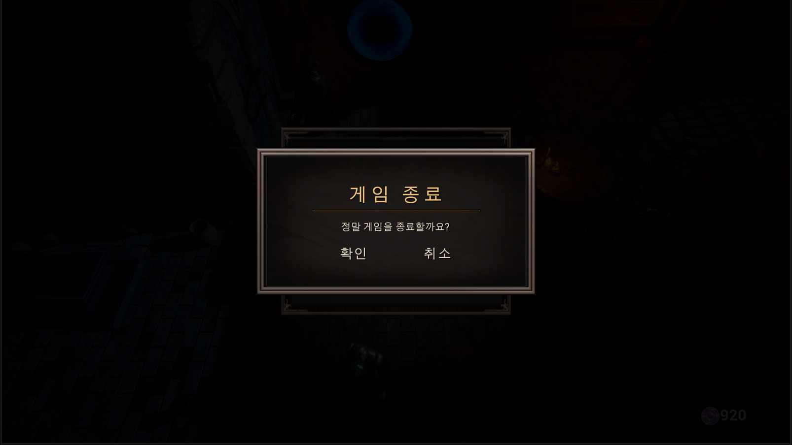
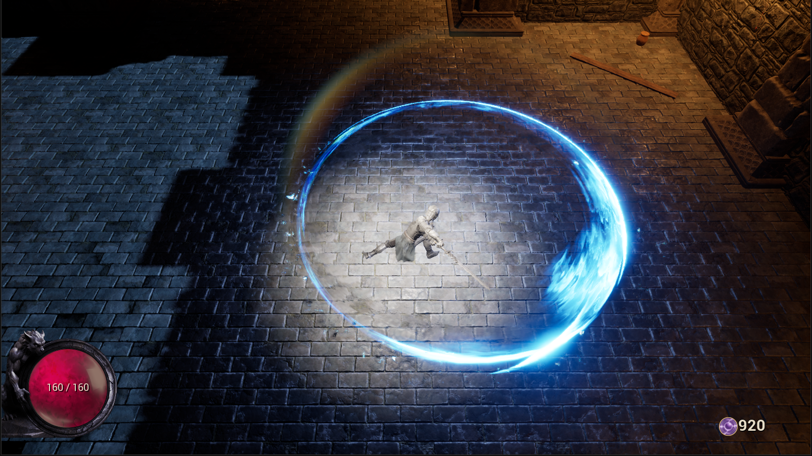

# JY_Roguelike (현재 진행 중)

## 프로젝트 소개

게임 「하데스(Hades)」의 방 단위 런 구조에 핵 앤 슬래시 전투를 넣은 3D 쿼터뷰 액션 로그라이크입니다. 축복 시스템은 하데스에서 착안했습니다.

 

## 개발 환경

### 엔진 · 기술

| 구분 | 내용 |
|---|---|
| 엔진 | Unreal Engine 5.8 |
| 언어 | C++ |
| 사용 기술 | Gameplay Ability System · Mass Entity · MVVM (UMG ViewModel) |
| 네트워크 구조 | 서버·클라 분리 구조 (Play As Client) |

### AI 환경

| 구분 | 내용 |
|---|---|
| 도구 | - Claude Code |
| 공용 규칙 | - 설계는 사람이 정하고 AI는 승인받은 것만 구현 - 엔진 소스를 확인하고, 공식 레퍼런스 프로젝트가 있으면 그것도 확인한 뒤 판단 - 추측 금지 — 확인 못 한 것은 미확인으로 표시 - 커밋은 승인 후 |
| 스킬 | - 빌드 · 레퍼런스 확인 · 코딩 컨벤션 - 구조 설계 · 디버깅 - 구조도 · 흐름도 생성 |
| 훅 | - 세션 시작 때 진행 문서 불러오기 - 에디터 실행 확인 - 빌드 누락 검사 |
| 에디터 연동 | - 언리얼 에디터 MCP - 에디터 전용 C++ 툴셋 (StateTree · AnimGraph · Level 등) |
| 진행 관리 | - 기능별 진행 문서에 기록 - 결정과 이유 · 지금까지 한 일 · 다음 할 일 · 막힌 문제 |

 

## 클래스 구조도

[클래스 구조도 보기](https://hanjongyun.github.io/JY_Roguelike/)

 

## Milestones

| 단계 | 목표 | 작업일 | 세부 항목 |
|---|---|---|---|
| **M1** | 기획 · 캐릭터 기반 | 4일 | ✅ 게임 기획 ✅ 에셋 후보 설정 ✅ 쿼터뷰 카메라 · 이동 ✅ GAS 기반 체력 시스템 ✅ CommonUI 도입 · UI 구조 설계 |
| **M2** | UI 시스템 | 2일 | ✅ CommonUI 기반 화면 층 구성 ✅ UI 관리자 Subsystem ✅ HUD (체력 · 영혼석) ✅ Tab 정지 메뉴 ✅ 확인 팝업 ✅ MVVM 데이터 바인딩 |
| **M3** | 로비 | 3일 | ✅ 배너 · 토스트 알림 ✅ 상호작용 시스템 ✅ 기록판 ✅ 포털 · 맵 이동 ✅ 영혼의 제단 (메타 강화 구매 · 환불) ✅ 서버 세이브 ✅ 맵별 HUD 표시 · 커스텀 커서 |
| **M4** | 이동 · 전투 | 4일 | ✅ 이동 애니메이션 · 점프 · 2단 점프 · 대시 ✅ 타이틀 · 로딩 화면 · 심리스 맵 이동 ✅ 기본 공격 콤보 (지상 · 공중) ✅ 서버 피격 판정 · 피격 반응 ✅ 스킬 슬롯 · 쿨타임 ✅ 찌르기 · 회피 · 내려찍기 ✅ 카메라를 가리는 벽 페이드 |
| **M5** | 던전 | 5일 | ✅ 방 6종 (전투 · 상점 · 보스) ✅ 함정 3종 ✅ 부서지는 오브젝트 5종 ✅ 레벨 스트리밍 기반 방 전환 ✅ 무작위 방 순서 ✅ 방 클리어 · 출구 문 잠금 ✅ 오브젝트 파괴 연출 |
| **M5.5** | 전투 리팩토링 | 2일 | ✅ 피격 반응 공용 컴포넌트 · 공중 넉백 ✅ 공격 · 함정 · 폭발 판정 통일 ✅ 함정 상태이상 (화상 · 중독) ✅ GA 구조 개편 (공격 공용 부모 · AbilityTask 분리) ✅ GameplayEffect 데이터 에셋화 |
| **M6** 🚧 | **기본 몬스터 (현재)** | 12일 (진행 중) | ✅ Mass Entity 구조 설계 🚧 Mass Entity 기반 대규모 몬스터 (서버 → 클라 복제 골격 완료) ⬜ 웨이브 · 추격 · 전투 ⬜ 기본 몬스터 4종 · 엘리트 |
| **M7** | 축복 | — | ⬜ 축복 시스템 (3계열 · 9종 + 조합 3) ⬜ 상태이상 (화상 · 빙결 · 감전) · 몬스터 적용 ⬜ 축복 선택 화면 ⬜ 스킬 · 축복 슬롯 HUD |
| **M8** | 보스 | — | ⬜ 3페이즈 보스 패턴 ⬜ 보스 HP바 |
| **M9** | 런 루프 | — | ⬜ 사망 처리 ⬜ 방 보상 오브 · 문 위 보상 아이콘 ⬜ 사망 · 클리어 → 로비 복귀 ⬜ 골드 · 상점 ⬜ 소모품 인벤토리 · 스탯창 ⬜ 설정 화면 ⬜ 피해 숫자 |

 

## 진행 상황 참고자료 (스크린샷)

| 타이틀 | 로비 도착 배너 |
|---|---|
|  |  |
| **영혼의 제단 (메타 강화)** | **정지 메뉴** |
|  |  |
| **포털 확인 팝업** | **종료 확인 팝업** |
|  |  |
| **던전 인게임 (HP 바)** | |
|  | |
